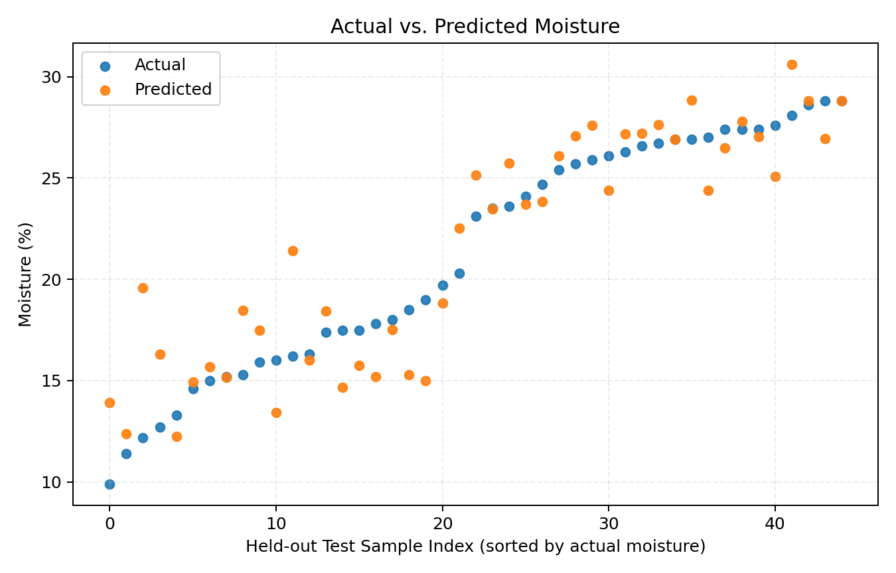

# Rice Paddy Moisture Prediction via Image Color Analysis

[](https://ieeexplore.ieee.org/document/11320486)
[](https://mongzaza.github.io/Rice-Moisture-Predict-via-Color/)
[](code/requirements.txt)

Official implementation and dataset for our paper:

> **[Developing Prediction Model for Estimating Moisture of Rice Paddy using Correlation Between Color Values of Rice Paddy and Moisture Content](https://ieeexplore.ieee.org/document/11320486)**  
> *Kirati Pothidang, Ritchanon Bunseng, Waiyawat Suansawan*  
> Department of Mathematics, Princess Chulabhorn Science High School Phetchaburi, Thailand  
> Published in *IEEE iSAI-NLP 2025* · [IEEE Xplore](https://ieeexplore.ieee.org/document/11320486) · [Web Demo](https://mongzaza.github.io/Rice-Moisture-Predict-via-Color/)

---

## Overview

Accurate moisture measurement is essential for pricing harvested rice paddy and preserving milling quality. Conventional oven-drying is slow and destructive, while portable moisture meters are costly and drift without frequent calibration.

This project provides a **low-cost, non-destructive computer vision & regression pipeline** that predicts wet-basis moisture content (%) directly from RGB images of unmilled (husked) Thai rice paddy captured in a simple 20 × 20 cm lightbox.

### Pipeline Architecture


---

## Dataset

### Data Collection & Setup

- **Location / Source:** Thai rice paddy samples supplied by **Poonsin Thai Ricemill** (Suphanburi, Thailand).
- **Imaging Setup:** Controlled **20 × 20 cm lightbox** with fixed artificial lighting, camera distance, and angle.
- **Camera & Settings:** **FUJIFILM X100T** (`4896 × 3264` px), fixed **ISO 200**, aperture **f/11**, shutter speed ~`1/10` – `1/14` s (consistent across all captures).
- **Collection Timeline & Dataset Scope:**
  - **Main Dataset (`0001.jpg`–`0296.jpg`, 296 samples, Jun 2024 – Apr 2025):** Initial collection used for feature selection (`data/features/`), OLS model training, and all results reported in the IEEE iSAI-NLP 2025 paper and `outputs/`.
  - **Extra Dataset (`data/extra_dataset/`, `0297.jpg`–`0512.jpg`, 216 samples, Jul 2025 – Aug 2025):** Additional samples collected afterward under the exact same FUJIFILM X100T lightbox setup (moisture `12.7%`–`30.1%`, mean `21.28%`), stored separately with its own `mapping.csv` and `pictures/`.

| File / Folder | Samples | Moisture Range | Description |
| :--- | :---: | :---: | :--- |
| `data/mapping.csv` | **296** | 9.6% – 30.2% (mean 21.08%) | Ground-truth moisture labels (`0001.jpg`–`0296.jpg`) |
| `data/pictures/` | **296** | — | Raw FUJIFILM X100T lightbox paddy images (`0001.jpg`–`0296.jpg`) |
| `data/features/` | **296** | 9.6% – 30.2% (mean 21.08%) | Extracted color feature tables (`All_color.csv`, `Green_color.csv`, `Brown_color.csv`, `Correlated_FULL.xlsx`) |
| `data/extra_dataset/` | **216** | 12.7% – 30.1% (mean 21.28%) | Later collection (`mapping.csv` + `pictures/` for `0297.jpg`–`0512.jpg`) |

---

## Results

Evaluated using a 10-decile stratified 85/15 split (`N_train = 251`, `N_test = 45`, `seed = 42`):

| Metric | Value |
| :--- | :---: |
| Total Studied Variables | 243 (81 × 3 segments) |
| Retained Features (`\|r\| ≥ 0.80`, `p < 0.01`) | 38 (36 Green + 2 Full) |
| Top Single Predictor | Green `Entropy_S` (`r = +0.8964`, `p = 6.51e-106`) |
| Held-out **RMSE** | **2.270%** |
| Held-out **MAE** | **1.703%** |
| Held-out **MAPE** | **9.75%** |
| Held-out **R²** | **0.840** |
| Training **R² / Adjusted R²** | 0.901 / 0.884 |
| Regression ANOVA **F(38, 212)** | 51.013 (`p = 7.11e-87`) |
| Regression ANOVA **SS_Total / MS_Res** | 8431.127 / 3.9198 |

### Actual vs. Predicted Moisture



> **Multicollinearity Note:** As discussed in Section V.B of the paper, the 38-feature OLS design matrix exhibits severe multicollinearity (in particular, `TGI = (130/3)ExG − (25/3)ExB` identically). While held-out predictions remain accurate (`R² = 0.840`), individual raw regression coefficients should not be interpreted in isolation; future iterations should apply regularization (Ridge/ElasticNet) or parsimonious feature selection.

---

## Repository Structure

```text
rice-moisture-prediction/
├── README.md
├── .gitignore
├── data/
│   ├── mapping.csv                        # Ground-truth moisture labels (0001.jpg–0296.jpg)
│   ├── pictures/                          # Raw lightbox images (0001.jpg–0296.jpg)
│   ├── features/                          # Extracted 296-sample color feature tables
│   │   ├── All_color.csv
│   │   ├── Green_color.csv
│   │   ├── Brown_color.csv
│   │   └── Correlated_FULL.xlsx
│   └── extra_dataset/                     # Later collection (0297.jpg–0512.jpg)
│       ├── mapping.csv
│       └── pictures/
├── code/
│   ├── config.py                          # Hyperparameters, HSV ranges, and feature manifest
│   ├── 01_preprocess_and_extract.py       # Crop, Hue denoise, HSV split, 81×3 color features
│   ├── 02_correlation_select.py           # Pearson r & p-value feature screening
│   ├── 03_train_and_evaluate.py           # Stratified OLS training, ANOVA, and evaluation
│   ├── predict.py                         # Single-image / batch CLI moisture inference
│   ├── run_pipeline.py                    # End-to-end pipeline entrypoint
│   ├── build_demo_site.py                 # Builds docs/data/demo_data.json and 6-stage sample images
│   └── requirements.txt
├── docs/                                  # Interactive web demo (GitHub Pages /docs)
│   ├── index.html
│   ├── styles.css
│   ├── app.js
│   ├── data/demo_data.json
│   └── assets/samples/                    # 6-stage visual pipeline previews for 12 test samples
└── outputs/                               # Saved metrics, ANOVA table, equation, plot, and model bundle
```

---

## Citation

If you use this code or dataset in your research, please cite:

```bibtex
@inproceedings{pothidang2025rice,
  author    = {Pothidang, Kirati and Bunseng, Ritchanon and Suansawan, Waiyawat},
  title     = {Developing Prediction Model for Estimating Moisture of Rice Paddy using Correlation Between Color Values of Rice Paddy and Moisture Content},
  booktitle = {Proceedings of the International Joint Symposium on Artificial Intelligence and Natural Language Processing (iSAI-NLP 2025)},
  year      = {2025},
  publisher = {IEEE},
  url       = {https://ieeexplore.ieee.org/document/11320486}
}
```

## Acknowledgments

We thank **Mr. Jirakoon Erbim** (Department of Mathematics, Princess Chulabhorn Science High School Phetchaburi) for his mentorship and **Mr. Nat Satapanapitakkit** of **Poonsin Thai Ricemill** (Suphanburi, Thailand) for providing the rice paddy samples.
